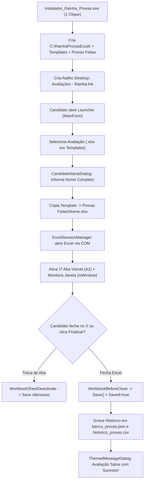

---
tags:
  - arquitetura
  - fluxo
  - com
  - csharp
---

# 🏗️ Arquitetura e Fluxo do Sistema

Voltar para: [[00 - Dashboard (MOC)]]

## 🔄 Fluxo Ponta a Ponta

---

## 🧩 Módulos do Código-Fonte

| Arquivo | Responsabilidade |
| :--- | :--- |
| `RainhaLauncherProvas.csproj` | Projeto `.NET 10 Windows Forms`, empacotamento `PublishSingleFile` e recursos embutidos (`EmbeddedResource`). |
| `Program.cs` | Ponto de entrada: roteamento entre Launcher, Instalador (`--install` / `--silent-install`) e autoteste (`--self-test`). |
| `AppConfigAndStorage.cs` | Diretórios, extração dos templates oficiais, criação de atalho (`WScript.Shell`), hash SHA-256 (`config_admin.json`), tema (`ThemePalette` / `config_theme.json`) e histórico JSON/CSV. |
| `ExcelSessionManager.cs` | Automação COM do `Excel.Application`, conexão `IConnectionPoint` (`AppEvents`), ativação da 1ª aba e monitoramento Win32 (`IsWindow`). |
| `MainForm.cs` | Tela principal, listagem dinâmica de avaliações, cronômetro ativo e alternância Modo Claro / Noturno. |
| `CandidateNameDialog.cs` | Modal de captura e validação do Nome Completo. |
| `AdminLockDialog.cs` | Modal do cadeado (`🔒`), acesso às pastas restritas e alteração/reset de senha. |
| `ThemedTitleBar.cs` | Barra de título própria responsiva ao tema (compatível com Windows 10 IoT, 10 e 11). |
| `ThemedMessageDialog.cs` | Pop-up temático substituindo o `MessageBox` padrão do Windows. |
| `InstallerForm.cs` | Interface do Instalador Único de 1 clique. |

---

## 🔗 Notas Relacionadas
- [[02 - Regras de Negócio (RN01-RN11)]]
- [[04 - Estrutura de Dados e Arquivos]]
